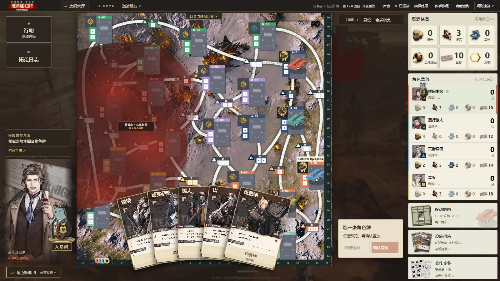
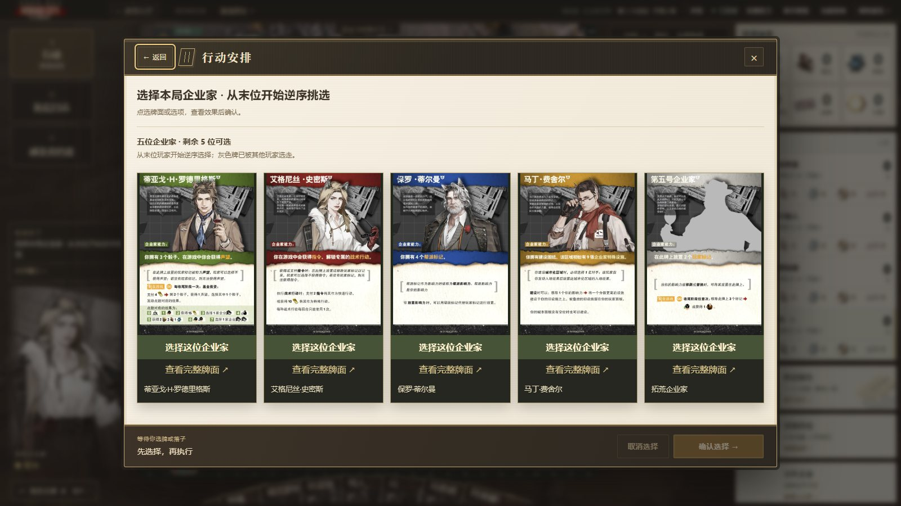
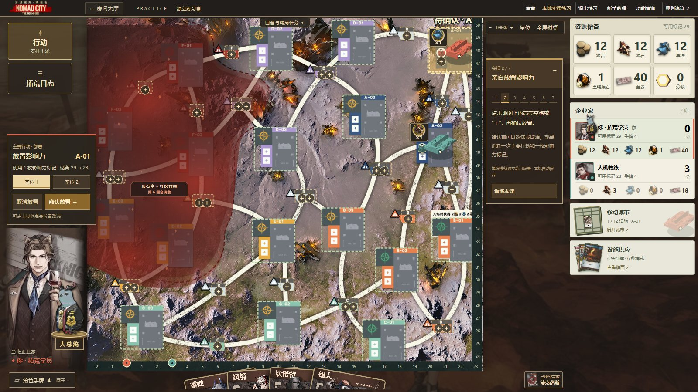

<div align="center">

# 明日方舟 · 游城拓荒

**四位企业家，一张棋桌，八回合的拓荒之旅。**

《游城拓荒：铸基者》的非官方浏览器联机实现。约上朋友，秘密盖放角色，驾驶移动城市，在荒野中建设、探索与争夺影响力。

[](https://github.com/ignorantichliebedich/arknights-nomad-city/actions/workflows/check.yml)


[进入游戏](http://106.52.74.24) · [本地启动](docs/quickstart.md) · [操作指南](docs/how-to-play.md) · [更新记录](CHANGELOG.md)

</div>

[](http://106.52.74.24)

> **版本导航**：默认分支提供本体与企业扩展代码；本页实机截图来自 **v0.8.1 开发版**，包含感染者与新版棋桌。最新开发源码与合并进度见 [感染者开发 PR #1](https://github.com/ignorantichliebedich/arknights-nomad-city/pull/1)。

## 一起把棋桌展开

保留原桌游的棋盘、牌面与城市配件，把记账、行动校验和结算交给系统。选哪张角色、往哪里走、先建什么，仍由你决定。

- **朋友随时入座。** 创建私人邀请房间，用链接或六位房间码集结；支持 2–4 位玩家，也能让人机补齐空席。
- **落子就在地图上。** 拖动移动城市与影响力，点选合法目标；扇形手牌支持悬停放大、双击盖放，事件以卡面和选项展开。
- **一起选牌，一起规划采集。** 秘密盖放与回合末采集支持并行选择，全员确认后推进。手牌、秘密选择与私人日志各自可见。
- **从第一枚棋子开始学。** 七课实操使用正式棋桌与规则，涵盖选牌、部署、移动、探索、建设、策略和采集；可以重练或刷新继续。
- **把这一局留到下次。** 有效操作自动保存，断线保留席位。使用原浏览器和原房间地址，可在刷新或服务重启后接续对局。



_实际浏览器界面。截图使用独立演示房间和虚构昵称，点击图片可查看大图。_

## 从铸基者到感染者

| 玩法                    | 你将面对什么                                                                                               |
| ----------------------- | ---------------------------------------------------------------------------------------------------------- |
| **铸基者本体**          | 角色策略与计谋、地图探索、城市建设、资源采集，以及八回合后的区域控制与最终计分。                           |
| **企业扩展**            | 罗德岛、莱茵生命等八家企业；选择合作方向，推进等级，利用企业奖励和特殊能力。                               |
| **感染者扩展 · 开发版** | 新增干员与流形、公共设施、城市样式、岩蹄安保和梅兰德授勋；可进一步启用五位企业家的专属能力与奇数回合抉择。 |

本体可以独立开局；开发版的感染者玩法自动包含企业扩展。玩法在建房时选择，已有房间继续使用原规则版本。默认分支的创建界面提供本体和企业扩展选项，感染者选项位于开发分支。细节见[规则证据](docs/rules-evidence.md)、[感染者说明](https://github.com/ignorantichliebedich/arknights-nomad-city/blob/codex/oripathy-evidence/docs/oripathy.md)与[规则审计](https://github.com/ignorantichliebedich/arknights-nomad-city/blob/codex/oripathy-evidence/docs/oripathy-audit.md)。

<table>
  <tr>
    <td width="50%"><a href="docs/media/enterprises.jpg"></a></td>
    <td width="50%"><a href="docs/media/oripathy.jpg"></a></td>
  </tr>
  <tr>
    <td align="center"><b>合作企业</b><br>原版企业板、等级奖励与全员合作进度</td>
    <td align="center"><b>企业家与抉择</b><br>选择身份，建立这一局的经营方向</td>
  </tr>
</table>

## 第一次来，先亲手下一步

首页的 **「实操演习」** 会打开独立练习桌，人机教练陪你完成七项基础操作。练习进度保存在本机，随时可以退出回到原房间。**「拓荒指南」** 提供操作演示和角色、设施、企业的关键词查询。



桌面支持 Chrome、Edge、Firefox；手机提供横竖屏布局、触控选牌与双指缩放。首次进入可选择全屏，手机会尝试申请横屏；也可以保持窗口模式。声音设置包含操作音效、中日角色语音与唱片式音乐播放器。详见[手机棋桌](docs/mobile.md)和[声音说明](docs/audio.md)。

## 约朋友玩一局

1. 进入游戏，点击 **开始拓荒**，输入昵称并选择本局扩展。
2. 创建房间，将邀请链接或房间码发给朋友；人数不足时，房主可在 **邀请朋友 → 人机同行** 中添加人机。
3. 全员准备后，由房主开局。选牌、规划路线、执行行动，系统负责裁定与记账。

在线入口运行的是已验收部署版本；仓库代码与展示截图可能领先于公网。席位保存在浏览器中，继续一局时请沿用相同的浏览器、地址和协议。[查看发布流程](docs/release.md)

## 在自己的电脑上开桌

需要 **Node.js 24.14+（24.x）与 pnpm 11**。获取默认分支源码后，在项目根目录运行以下命令。若要体验截图中的感染者与新版棋桌，先切换到 `codex/oripathy-evidence` 开发分支。

```sh
pnpm install --frozen-lockfile
pnpm assets:restore
pnpm build
pnpm start
```

打开 [本地游戏入口](http://localhost:3000)；局域网朋友访问 `http://房主局域网IP:3000`。开发时使用 `pnpm dev`，前端地址为 `http://localhost:5173`。

运行图像与音效按来源清单另行获取并校验；背景音乐由本地 `music/` 导入。素材获取、来源重建、Windows 运行包、备份与恢复见[完整启动说明](docs/quickstart.md)。

## 给想继续建设的人

前端使用 React + Vite，棋盘采用原图与 SVG 交互层；Node.js 服务通过 HTTP / WebSocket 同步状态，SQLite 持久化房间、日志与待选步骤。独立 TypeScript 规则模块负责合法行动、效果执行、信息投影和计分。

| 想了解什么         | 从这里开始                                                                                                                                                                                        |
| ------------------ | ------------------------------------------------------------------------------------------------------------------------------------------------------------------------------------------------- |
| 规则与证据         | [本体／企业](docs/rules-evidence.md) · [感染者](https://github.com/ignorantichliebedich/arknights-nomad-city/blob/codex/oripathy-evidence/docs/oripathy.md) · [并行阶段](docs/parallel-phases.md) |
| 项目结构与本地检查 | [运行与开发](docs/quickstart.md#结构) · [验证命令](docs/quickstart.md#验证)                                                                                                                       |
| 修改与发布         | [贡献约定](CONTRIBUTING.md) · [发布流程](docs/release.md) · [更新记录](CHANGELOG.md)                                                                                                              |
| 自行部署与运维     | [部署说明](docs/deployment.md) · [安全说明](SECURITY.md) · [承压测试](docs/capacity-test.md)                                                                                                      |
| 报告问题           | [提交 Issue](https://github.com/ignorantichliebedich/arknights-nomad-city/issues)；附上版本、人数、扩展配置与复现步骤                                                                             |

更新先通过本地检查并推送 GitHub，经本地试玩确认后再部署；GitHub Actions 只运行源码、版本、测试和构建检查。

---

本项目面向朋友私人试玩，与鹰角网络及《明日方舟》官方无隶属关系。角色、美术、牌面、地图与声音的权利归各自权利人；仓库展示图为项目实机截图，原始运行素材、音乐、存档及凭证不随源码发布。[第三方说明](THIRD_PARTY_NOTICES.md) · [截图记录](docs/media/README.md)
